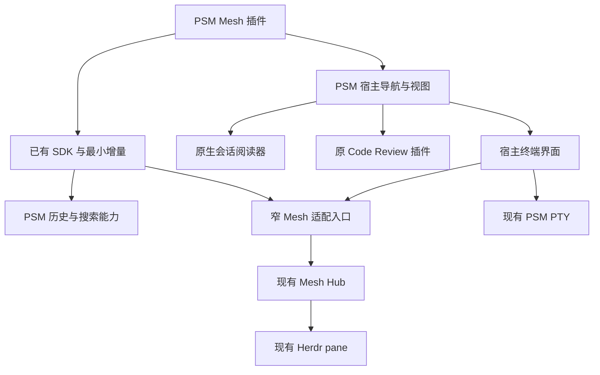

# Pi Mesh 的 PSM 插件方案与代码分析

> 日期：2026-11-01；更新：2026-11-02（Asia/Shanghai）
> 状态：v1.3；按用户决定，Mesh 消息/steer/follow-up/停止只走 Mesh。业务实现尚待按此对齐。
> 范围：先深读与规划，不在本轮实现插件、提交、发布或 push。
> 实施跟踪：[Issue](../issues/插件/20261101-pi-mesh-psm-plugin.md)

## 1. 目标与结论

把 Mesh Web 工作台的协作体验做成 PSM 插件，让用户识别正在工作的会话、直接读对话、核对变更、发送指令和接手终端。重点是复用 PSM 已有功能，并补齐阻碍复用的少量宿主接口。

推荐首版是 PSM 仓库内的 `extensions/psm-mesh/`；现场已采用 ID `builtin.psm-mesh`，沿用它，不另建第二个 ID。它是协作入口与视图投影，不拥有第二套会话库、消息渲染器、Review 引擎或 PTY 管理器。

- PSM 负责：历史会话与搜索、原生会话阅读、共享输入界面、工具渲染、Review、终端界面、设置与插件生命周期。
- 现有 Mesh Hub + 目标 Mesh 扩展负责：消息、steer、follow-up、停止，以及 peer 生命周期、关注通知、Git/worktree、文件活动、恢复 CAS 和 Herdr 接管。
- Mesh 插件负责：列表分组筛选、选中目标、协作来源、行为入口和少量插件视图状态。
- Mesh 插件四项控制只有 Mesh 执行链；双注册目标也不用 Pi Live/bridge，失败无手动或自动回退。PSM 其他入口的既有 Pi Live 功能不属于本次插件控制设计。

不要求用户先淘汰 Mesh CLI/TUI/Web，也不强行把 Mesh 独立 Web 的框架、浅色默认值和布局外壳搬入 PSM。Mesh 的零模型工具约束继续保留：启用协作插件不能成为强制增加 Pi 工具表的理由。

## 2. 首次分析基线与当前审查现场

| 项目 | 已核实基线 |
| --- | --- |
| PSM | `/Users/dengwenyu/Dev/AI/pi-session-manager`；当前分支 `main`，本地与现有 `origin/main` 引用一致；HEAD `385bc70f521386aa760110abd9eb2e82e9eee38f`；版本 0.9.1。未 fetch，不声称这是远端最新提交 |
| PSM 已有修改 | `extensions/pi-session-bridge/src/tools.ts`、`tools.test.ts`、`src-tauri/src/tray.rs`；本轮不修改这三个文件 |
| Mesh | `/Users/dengwenyu/.pi/agent/extensions/pi-mesh`；不是独立 Git 仓库；上层仓库是 `/Users/dengwenyu/.pi/agent`，Mesh 整个目录显示未跟踪 |
| Mesh 父仓库 | `main`，HEAD `d7739607b7b4ede8ac17614a080962b40febf407`；这不是 Mesh 自身的版本号 |
| 历史上下文 | 前轮 WebUI review 强调会话／变更／终端、真实状态、文件身份与展示路径分离、会话独立草稿、IME 与回执保护。以当前代码重新验证，不把旧缺陷直接当成现状 |

### 2.1 自审开始时的新增现场

同一 HEAD 下已有未提交实现：`extensions/psm-mesh/`、SDK types/client/manifest、Registry summary、dispatch、App terminal-open 和权限等，另有 [PSM Mesh 集成草案](../PSM_MESH_PLUGIN_DESIGN.md)。本次自审仅修改本方案和关联 Issue，保护全部已有业务改动，不只最早三个文件。

现场已出现 `ctx.psm.liveAgents.list()`、`ctx.psm.terminal.open({cwd,label?})`、`live-agents:read`、`terminal:open`、`AppPluginSurfaceData.terminalAvailable`。它们是待验收代码，不能按不存在去重复开发，也不代表已发布稳定 API。

另一草案的“PSM Live 总览”范围比完整目标小；2026-11-02 已将其标为历史草案，并明确旧 Pi Live 控制/bridge 前置条款失效。本方案为当前 SSOT，关注/Herdr 等仍按已审完整目标，不将旧精简稿视作用户批准的需求缩减。

首次分析的测试与“只有三个 dirty 文件”是历史证据，不能证明当前新增实现已通过验证。

### 2.2 Mesh 已有行为契约

Mesh 当前 `docs/design.md`、`app.js`、`review.ts` 与测试已经包含前轮多数改进：

- 三视图迁移、首次在线过滤、搜索跨状态、筛选隐藏目标时保留详情。
- 草稿按目标保存、每目标发送锁、请求快照、草稿版本保护、IME 保护。
- 超时显示结果未确认，明确拒绝保留草稿，不自动重发。
- canonical file key、文件深链接、成功／失败／待完成结果区分、50 条文件活动窗口。

这些是迁移验收基线。当前测试覆盖并不等于本轮完成了真实浏览器验收。

## 3. 两个项目的真实链路

### 3.1 Mesh

`index.ts → hooks.ts → MeshClient → HubRouter/Registry`：

- Pi 生命周期注册 peer；`sessionId` 取 Pi 会话 ID，`persistence` 来自运行时。
- agent_start / agent_settled / agent_end 与心跳维护 running / waiting；超时才判 offline；显式 close 才是 closed。
- 文件活动来自工具调用，不是 Git 状态，也不是文件系统 watcher。
- Hub 处理 send_message 后向目标扩展 push；目标调用 Pi 的 `sendUserMessage({deliverAs})`。
- 关注是 session → session 的有向边；消息成功可自动建立边；通知回到关注者扩展且不触发回合。
- resume 经过 Hub CAS 租约，再由既有 Herdr 编排恢复同一 JSONL。
- 独立 Web 的历史与 Review 自己读 JSONL；终端经 Hub WS 连接 `herdr terminal session`。

协议事实以 Mesh `src/protocol.ts` 为主；Review 的结构目前另在 `src/hub/review.ts` 定义，不能假设所有 HTTP 响应都已集中导出。

### 3.2 PSM

`pi-session-bridge → BridgeConnection → PSM WS/realtime → PiAgentRegistry → RPC → Pi`：

- 已有在线注册、事件转发、重连、并发 RPC correlation 与连接代次保护。
- 已有 prompt / steer / follow_up / abort / model / thinking / commands。
- 原生 `useSessionViewerData` 优先尝试 Pi Live，回落到 PSM 的历史数据读取和增量加载。
- `PiLiveChatInput` 已有输入、slash commands、历史、队列展示和停止入口。
- HTTP 与 WS 命令汇入 dispatch；插件在 Tauri 上通过 `plugin_dispatch_command` 进入同一能力路由。
- `TerminalManager` 已有 portable_pty shell、输入、resize、关闭和 transcript；前端用 xterm。
- `psm-code-review` 已有工具操作提取、文件树、diff、Shell 列表与工具调用定位。

重要发现：Mesh `hub/review.ts` 文件头明确写明其领域逻辑移植自 PSM 的 `psm-code-review/tool-review/{model,viewModel}`。插件版不应该再反向复制一整份 Review。

## 4. 能力复用矩阵

“宿主内部”表示确实存在，但不等于当前外部插件 SDK 已公开。

| 需求 | PSM 已有实现 / API | Mesh 已有实现 | 处理方式 |
| --- | --- | --- | --- |
| 历史会话、项目、预览、分页 | SDK sessions.list / readEntries / readFileChunk；PSM scanner/cache | peer 留存不能替代完整历史库 | 复用 PSM，不扫描第二遍 JSONL、不自建索引 |
| 全文搜索 | SDK search.fulltext；PSM 数据层 | Web 内存筛选 | 列表轻筛选由插件做，历史检索用 PSM |
| Markdown、Mermaid、工具结果 | 原生 SessionViewer 与工具 renderer | satteri + 独立 sanitizer | 用原生阅读器，不把 Mesh 服务端 HTML 注入 PSM |
| 在线会话与收发 | 宿主界面可复用；Registry/bridge 是背景能力 | Hub peers/socket/push | 在线可控性取 Mesh；消息/steer/follow-up/停止全走 Mesh，无 Live RPC |
| 在线状态与活动 | PSM EventBus 可转发适配事件，原生阅读器可复用 | Hub SSE peers/file_activity | 插件不以 usePiLive/bridge 为前置，不伪造 Mesh 未提供的队列/流式正文 |
| Review / 文件树 / diff | psm-code-review（内置插件） | 从 PSM port 后增加 canonical/outcome 修复 | 增强 PSM 原 Review，Mesh 插件只打开它 |
| 会话内定位 | session UI props.viewer.revealEntry / revealToolCall / navigateBranch | Web URL 文件定位 | 复用宿主控制器；补文件 surface 定位回调 |
| 宿主内选中会话 | AppPluginSurfaceData.onSelectSession；command context.navigate.openSession | Web 自管 selected/hash | 复用宿主导航，补公开类型；sessions.open 默认不是此能力 |
| 标签、收藏、持久配置 | SDK tags/favorites/config/records/settings/i18n | Mesh localStorage | 直接复用；运行状态不能混成 Kanban 手工状态 |
| 项目 shell / 恢复命令 | TerminalPanel、useTerminalScopes、sessionResume、既有 host callback；现场 terminal.open 草稿 | Herdr 新建/恢复 | shell 复用 PSM；Mesh 恢复经统一路由且通过第 7.F 放行门槛 |
| 终端历史 | SDK terminalHistory + terminal:read | Herdr pane 重放 | 不混淆两种历史来源 |
| 已有 Pi pane 接管/观察 | PSM 当前 PTY 不具备外部 pane attach | Hub terminal.ts + Herdr | 复用 Mesh 连接；PSM 承载显示与生命周期适配 |
| Git repo/branch/worktree | 当前 SessionInfo/PiLiveSession 没有这套字段与公共 API | GitInfo/resolveGitInfo | 先复用 Mesh 元数据，缺失时按 cwd 分组，不遍历所有历史目录执行 git |
| 关注与会话间通知 | SDK tags/favorites/records 都不是会话关注协议 | Registry.following、hooks、notify | 保留 Mesh SSOT；不能用收藏或 records 假装实现 |
| 恢复互斥与血缘 | PSM 能生成恢复命令，没有等价 Mesh CAS | claim_resume / record_resume / resumptions 存在已复现缺口 | 在同一 Hub 修正 token/确认与释放后复用；未过验收不开放恢复，不造第二把锁 |
| 插件装载与故障清理 | builtins、UiContributionCatalog、PluginContributionBoundary、activate/dispose | 不适用 | 复用 PSM 的注册、排序、权限与回滚体系 |

## 5. 迁移前必须处理的缺口

### 5.1 已实测：PSM Review 会错误合并文件

当前 `viewModel.ts::normalizeReviewPath` 会删除 `/src/` 等前面的目录，再把结果用于 `buildReviewTreeModel` 的 Map key。

本轮最小运行结果：

| 输入文件 | 当前归一化结果 |
| --- | --- |
| /work/repo-a/src/main/java/com/acme/App.java | src/main/java/com/acme/App.java |
| /work/repo-b/src/main/java/com/acme/App.java | src/main/java/com/acme/App.java |

传入两个操作后，实际得到 **1 个 file node，包含 2 个操作**。这是模型身份错误，不是 CSS 问题；现有 Review 测试通过也没有覆盖这个案例。

修复落点在 PSM 原 Review：

1. 工具参数原始路径保留为 sourcePath。
2. 用会话 cwd 做词法路径解析，得到 canonicalPath/fileKey；不随意去掉 repo/package 段。
3. displayPath 只负责缩短；文件树、选中项、深链接和导航都携带 fileKey。
4. 绝对与相对别名指向同一文件时可合并；两个 worktree 或包下同名文件必须分开。
5. Windows drive/UNC、分隔符、..、未知 cwd 都要有明确行为；浏览器模块不能直接复制 Node path 依赖。
6. canonical 是词法身份，不冒充 realpath；不为展示读取真实文件或解析 symlink。
7. 迁移 Mesh 的行为测试与 outcome 思路，保留 PSM 已有 read/task/image 等更广操作支持。

### 5.2 已核实：PSM 输入组件尚未继承 Mesh 的保护

源码 `PiLiveChatInput.tsx` 仍用局部 input/sending，RPC 成功后无条件 `setInput("")`；Enter 分支未检查 composition/isComposing/keyCode 229。

因此复用时要增强**同一个 PSM 输入组件/控制器**：

- per-session draft + revision；发送冻结 target/text/mode/source。
- 回执仅清空所提交且仍未改动的版本；切换目标后不会清空另一会话。
- 在途锁跨组件实例；发送时继续输入的新内容必须保留。
- 明确 accepted / rejected / unknown；RPC 返回不是模型执行完毕。
- 超时不自动重试、不换通道；IME Enter 只提交候选字。
- 保留原有 slash command、队列、输入历史与图片能力。

这里的竞态判断来自源码；本轮没有用真实输入法重现 PSM UI。

### 5.3 已核实：SDK 文档的能力总表落后于代码

真实 SDK 还包含 favorites / fs / widgets / windows / terminalHistory；AppView 还有 `mainContent: "keep"`，Dev Preview 也已存在。审计文档的部分总表未同步。

实施应先核对 `packages/runtime-sdk/src/types.ts` 与 `client.ts`，不能根据旧总表重复添加已有方法。

### 5.4 已核实：sessions.open 与 ctx.psm.agent 不能代替目标能力

- `sessions.open(path)` 调用 open_session_in_browser，打开系统浏览器中的 PSM 页面，不能当作当前窗口内导航。
- command context 已有 navigate.openSession，但只在命令上下文，不是所有 render props 都有。
- `ctx.psm.agent` 创建的是插件拥有的 agent session，不是“连接用户当前 Pi 会话”。用它发协作消息会走错会话。

### 5.5 已核实与待验证：事件、运行时和身份边界

- SDK 有 events.subscribe；当前 Live 事件转发来自 `usePiLive`，受设置/挂载影响。多个消费者各自调用 hook 会分别订阅并转发；这不是独立于 UI 的唯一宿主事件源。
- Registry 当前 list 会连 entries 一起返回；公开列表应投影 summary，避免每次列表请求传全量对话。
- Registry disconnect 会删除 live record；“没有 Live 连接”只代表不可在线控制，不代表 closed。
- Registry 查询/RPC 存在 contains 的模糊 ID 回退。新控制入口必须先 exact resolve，歧义失败，不能把截断 ID 当完整标识。
- Pi Live、AppState、PTY 受 gui feature gate 约束。若浏览器连接的是运行中的 GUI 后端，可复用；standalone CLI/headless 不能直接承诺同等能力。
- 当前非 GUI 分支若干 Live 命令可能返回 sent 或空对象而未执行 RPC。新接口必须明确 unavailable，不复用假成功响应。
- Registry entries 是注册快照；普通 live event 路径记录状态/计数但未追加这些 entries。不能把 get_pi_agent_entries 宣称为任意时刻都最新的完整 transcript；持续内容由既有 viewer 事件归并处理。
- 临时会话没有 JSONL：保持 Mesh 原语义，允许在线状态与控制，历史/Review/恢复明确不可用；不伪造文件路径。

### 5.6 历史背景：bridge 装载不属于 Mesh 控制依赖

PSM 根 package.json 的 `pi.extensions` 仍指向 `./extensions/pi-session-bridge.ts`，该文件当前不存在；实际入口在 `extensions/pi-session-bridge/src/index.ts`。这会影响经根包声明加载的方式，不能据此断言用户当前的直路径安装也失效。

实际 index.ts 无条件 registerTool 五次（search/context/recall/status/label）；connection-manager 的 liveModeEnabled 默认 false，PSM 前端默认 piLive.enabled 也为 false。只实现 PSM UI 插件不会让所有 Pi 会话自动出现在 Live Registry。

2026-11-02 用户已指定 Mesh 执行四项控制。上述 bridge 入口、工具表、Live 开关问题移出本插件前置；不为本需求新建 transport-only bridge 或改用户安装配置。未装 bridge、Pi Live 关闭时，Mesh 发现、消息和停止仍应可用。PSM 自身 bridge 的维护另行处理。

## 6. 推荐架构与事实归属

### 6.1 不新增事实源

| 数据 | 唯一负责方 |
| --- | --- |
| 历史 JSONL、索引、搜索、会话渲染 | PSM |
| Mesh 目标可控性、发送/停止回执 | 既有 Mesh Hub + 目标 Mesh 扩展；PSM Live 连接不授予 Mesh 控制能力 |
| Mesh running/waiting/offline/closed、关注边、GitInfo、文件活动、恢复租约 | Mesh Hub |
| 选中项、筛选、折叠、草稿、阅读位置、显示中的 surface | 宿主已有状态 + 插件私有视图状态 |
| shell 进程与 PTY | PSM TerminalManager |
| Herdr pane 与已有会话进程 | Herdr；Mesh 只桥接，插件只 attach/detach |

PSM Live 与 Mesh 状态可能不一致，分别保留来源与新鲜度，不回写覆盖。PSM 历史会话缺少 Mesh record 时显示“未连接/历史”，不能推断它“已关闭”。

### 6.2 会话关联

把“稳定会话资源”与“当前执行连接”分开：persisted 资源由后端 host/source、规范化完整 sessionPath 与 header sessionId 校验；控制连接另外保存 provider/fullLiveId，不能上线/离线就更换资源键。

1. 同后端/来源的完整 path 与 ID 必须一致；字段冲突即拒绝关联。
2. 只有路径缺失且候选唯一、无冲突时，才按完整 UUID 回落。不能跨 machine/source，也不能只靠 cwd/尾八位。
3. 每个 live 实例至多关联一个 persisted 资源；同 UUID 多路径保留冲突，不以 Map 最后覆盖值决策。
4. 未命中当前会话列表不证明 memory 或文件丢失。有真实 sessionPath 时复用 PSM resolver 查询/加载，不能直接禁用打开入口。
5. persistence 与索引/加载状态分开：明确 file、明确 memory、unknown；后者不能显示为临时会话。临时会话不伪造 JSONL。

展示名可短，控制标识完整。排序用稳定 created/startedAt + 资源键，缺时间用首次观察时间，不按心跳重排。selected/draft/read-position 按资源键关联；provider/fullLiveId 改变不丢草稿。

### 6.2.1 关注与收藏

Favorites 是“用户收藏会话”；Mesh following 是“来源会话关注目标并接收通知”。可以增加明确叫“收藏”的可选入口，不能把它命名为 Mesh 关注或代替来源、关注边和通知。缺来源时禁用真正关注并解释前置条件，不创建虚假的 PSM agent 身份。

### 6.3 用户确定的唯一 Mesh 控制链（2026-11-02）

`共享输入/操作界面 → PSM 宿主窄 Mesh adapter → 现有 Mesh Hub → 目标 Mesh 扩展 → Pi API`

adapter 仅转发现成协议并做类型/权限/目标校验，不重写 Hub、队列或 Pi 控制。

| 操作 | 既有 Mesh 请求 | 目标扩展执行 |
| --- | --- | --- |
| 在线消息 | send_message，沿用草稿 mode，默认 followUp | api.sendUserMessage(text, {deliverAs: mode}) |
| steer | send_message，mode="steer" | api.sendUserMessage(text, {deliverAs: "steer"}) |
| follow-up | send_message，mode="followUp" | api.sendUserMessage(text, {deliverAs: "followUp"}) |
| 停止 | cancel | 目标 latestCtx.abort() |

HTTP 复用 `POST /api/peers/:id/message` 与 `POST /api/peers/:id/cancel`；没有额外的 prompt RPC。完整 targetSessionId、text、mode、fromSessionId 和自动关注沿用 Mesh 契约。

- 双注册目标仍只走 Mesh；只有 PSM Live 的目标可读历史，但 Mesh 控制不可用。
- Hub 不可达、目标离线、拒绝或结果不确定时，保留草稿和请求快照；不向 bridge 重发、不回退、不启动替代会话。
- PiLiveChatInput 只复用界面/输入控制器。Mesh 模式必须注入固定 Mesh binding，缺失则禁用；空闲、slash 文本、快捷键、停止按钮都不能进入默认 usePiLive handler。
- 控制权限和可用性由 Mesh 连接/peer 决定，不依赖 PSM piLive.enabled 或 bridge 安装。
- Mesh 没有 PSM getCommands/模板展开契约，相关 UI 按 Mesh 实际能力处理，不调用 bridge 补齐。
- 回执仅证明目标 Mesh 扩展接受请求；现有 disposition 恒 started，不宣称模型已处理、精确入队或完成。未知结果不自动重试。

### 6.4 可用性与失败状态必须来自实际后端

可用性至少区分：尚未读取、成功快照为空、连接断开、明确不支持、权限被拒和读取失败。后四者不能变成“所有目标离线”。保留最后成功快照用于查看，但标 stale、停用不能证明可用的动作；恢复连接后重新校验目标/来源，保留草稿且不重发。

| 客户端 / 后端 | 当前证据 | 放行要求 |
| --- | --- | --- |
| Tauri 本地 + GUI | 有 Live Registry 与 PTY；新 terminal-open 是全局事件草稿 | 绑定本窗口的 host handler 后验证请求接受和 PTY 错误；不是发出 emit 就算打开成功 |
| Web + GUI 后端 | invoke 走 HTTP/WS，前端 listen 依赖后端 event_tx | 新 terminal-open 只 app_handle.emit、未 event_tx，源码链路不完整；修正前该动作明确 unavailable |
| Tauri 远程模式 | app transport 可用远程；plugin appPsmTransport 仍按 isTauri 选本地 IPC | 先对齐同一 backend identity；未修时禁止混用本地 live/pane 与远端 SessionInfo |
| headless CLI / 静态 dataset | 部分能力无 AppState/PTY，不能推断 GUI 等价 | 保留已有只读浏览；控制逐项报告 unsupported，不返回 sent |
| 移动端 | 原生移动会话层可复用；terminal surface 当前受限 | 浏览与回退需验收，终端 action 根据实际 capability 隐藏/禁用 |

后端标识随实际 endpoint/运行模式绑定，切换服务器时使旧请求代次与控制绑定失效，不能把同路径的两台机器合并。持久化筛选、阅读位置等沿用宿主已有机制；不为此新增通用环境/状态框架。

### 6.5 Mesh 事件与刷新复用一个宿主生命周期

Mesh peers/file_activity 取既有 Hub SSE，由窄 adapter 统一订阅/转发。usePiLive 多实例 relay 是 PSM 背景风险，不是本插件的事件源或必须重构的前置。

- 先订阅再取快照，期间变更标 dirty，合并 single-flight；只应用当前 backend/请求代次结果。
- 不为每行建立 Hub 连接；活动有来源、有界窗口和去重，不因多组件放大。
- 状态变化不重读 favorites/完整会话；详细阅读与 Review 继续复用 PSM。
- unmount/reload/禁用/拒权时取消订阅与请求代次；晚到响应不得恢复控制。
- 无 durable replay/sequence 不宣称 exactly-once 或补齐离线期间全部活动；重连用 Hub 快照纠偏。
- 断连显示 stale/不可用，不把 Pi Live 状态当 Mesh 的替代真相。

## 7. 最小增强方案（已有草稿与拟议增量分开）

### A. 首版采用内置插件，先复用宿主布局

使用 registerAppView + registerAppSidebarView，app view 选择 `mainContent: "keep"`。左侧是协作列表，右侧用原生阅读器。

但当前 `useAppViewNavigation::openPluginAppView` 仍无条件 setSelectedSession(null)；keep 只影响 renderDesktopMainContent，不能据此声称进入 Mesh 会保留对话。M1 要给既有导航补“keep 时保留当前选择/恢复该视图上次资源”的行为，并验证路由恢复、前进后退、刷新和移动端返回；没有可选资源时用真实空态，不挂第二份隐藏 viewer。

内置插件按项目规则可有意复用 `AppPluginSurfaceData`、sidebar shell 和宿主 hooks。对外的 npm/path/dev 版本只能依赖公开 SDK，不能复制内置 import 路径或打包 app TSX。

把需要暴露的最小会话列表/选择/surface 回调写成 SDK 导出的 .d.ts render data 契约；不要把整个私有 AppPluginSurfaceData 原样公开。命令继续用已有 context.navigate，不另造第二个路由系统。

### B. PSM 输入界面复用，执行绑定固定为 Mesh

已有 `liveAgents.list` 是 PSM 只读能力，不是本插件控制与在线发现的必要条件。不为本需求扩展 Live 控制 SDK，不移植 bridge 连接或 RPC。

共享输入器抽出小型类型化执行绑定，Mesh 插件强制注入既有 Mesh send/cancel。布局、输入历史、IME、独立草稿、版本回执、在途锁、错误展示继续复用。PSM 原生入口保留原行为；Mesh 模式缺 binding 必须 fail-closed，不落到默认 Pi Live。

按钮、Enter/Alt+Enter、slash-like 文本、行菜单、快捷键和停止统一经过 Mesh binding。使用 Mesh 草稿 mode/目标状态，不因 PSM isStreaming 推导另一条 prompt RPC。

窄 adapter 暴露已有 Mesh read/send/cancel/follow 等受控调用，并做 host/backend 权限校验；不开放任意 dispatch、URL、shell。按实际消费补 SDK/host 类型，不建设泛化控制框架。

### C. Review 在原插件内增强

保留 psm-code-review 的领域模型与渲染器。把当前 Modal 的内容提为可复用 surface，Modal 与 registerSessionMainView 共用；Mesh 只请求打开变更视图并定位 fileKey/toolCallId。

先修 canonical identity 与 outcome，再接入口，避免漂亮界面复用错误结果。Review 始终是“会话工具操作片段”，不是工作区最终 Git diff；pending/failed 不计成成功变更。

保持工具渲染分派与 provenance，尤其不再引入会把 Pi 原生 bash 当成 Grok Bash 的宽泛 matcher。

### D. 终端优先补“打开宿主终端”入口

沿用现场已有 `ctx.psm.terminal.open({cwd,label?})`，其当前语义仅是项目 shell 请求且尚未跨运行时验收；不再新增重叠的 `terminals.open`。resume 复用已有 host callback；pane 另加窄 host attach 请求，不能仅凭 cwd 猜语义。宿主拥有 renderer/scope/生命周期与权限，插件不拿 raw PTY 或任意命令执行器。

- project-shell：调用既有 scope；resume 通过统一宿主动作按资源归属路由，Mesh 管理资源必须走第 7.F 节，不能直接调用通用恢复 callback。
- existing-mesh-pane：由 sessionPath 精确映射到现有 Herdr target，经现有 Mesh WS 桥接；没有 pane 则明确不可接管。
- observe/control 分开授权；observe 必须在服务端阻断输入，不能只把输入框 disabled。
- close/hide/detach/kill 区分：退出插件或切 tab 不能杀掉用户已有 Pi pane。
- 新开终端应命名为“项目终端”；连接已有 pane 才叫“会话终端”。

PSM 目前 TerminalTabContent 的渲染生命周期与 terminal_create/close 绑定，主题/font 依赖也会触发 effect 重建。这是接入共享 terminal 前要审查的源码风险，尚未作真实进程复现；应先把进程所有权与视图挂载分开。

xterm 是现有宿主 renderer，优先验证其消费 Herdr ANSI 重放的可行性；不能未经验证承诺无缝兼容。先验证字节、鼠标、滚动、alternate screen、尺寸和后台切回，再确定必要适配，不同时引入第二套新终端栈。

### D.1 终端请求要有明确的界面所有者

当前实现 `plugin_terminal_open` 校验 cwd 后发全局 Tauri 事件并返回 null；App.tsx 可因 mobile/dataset/配置禁用而直接忽略。API resolve 只能证明 emit 成功，既不能证明请求方看到了终端，也不能保证不会影响另一窗口。

首版采用与调用渲染上下文绑定的 host handler：backend 校验目录，当前 frontend owner 打开既有 scope。沿用 terminal.open 名称，避免全局广播导航；请求带来源后端、owner/window 与 requestId，晚到请求不得重开已退出的视图。无 handler/能力关闭返回 unavailable，不静默吞掉。

区分“宿主接受打开请求”与“PTY 已就绪”。如果返回值仍为 void，它最多代表前者；PTY 创建失败由原生 pane 显示，不能先 toast“终端已创建”。Web/远程模式通过同等测试前不放行对应动作。terminal:open 只允许项目 shell，不隐式授权已有 pane 的观察/输入。

### D.2 不能忽略现有 attach 的独占语义

Mesh terminal.ts 的 attachByTarget 对同 mode:target 的新连接会杀掉旧桥接 child；它不区分旧连接仍活跃还是已经僵死。复用这条 WS 时可能抢走另一个 PSM 窗口或独立 Mesh Web 的 attach，observe 也不能假定可任意多开。

在现有桥接所有权表上补 live owner/attachId 与冲突结果：仍活跃则返回 attached，只有确定失效或用户明确执行“接管”才替换。detach 只关闭自己拥有的 bridge，旧 close/reconnect 不得移除新 attach；不另造 PTY 或平行锁。

### E. Mesh 专属能力用窄适配，复用现成 Hub

浏览器插件不能 import Node MeshClient，也不应把任意宿主路径或跨源 loopback fetch 当公共能力。

需要完整 Mesh 功能时，宿主增加固定配置目标的 Mesh adapter：只允许 peer 查询/SSE、follow/unfollow、send/cancel、resume/focus、Herdr 索引与 terminal 通道；读适配在 M0/M1 接入，动作逐项通过前置验收后开放。使用现有 HTTP/WS 协议，不搬运 Hub 领域状态到 Rust，不读写 registry.json，也不执行任意用户给的 URL/命令。

适配目标属于 PSM 所连接的后端主机，Hub 端口从该后端的既有 Mesh 配置读取；浏览器的 127.0.0.1 不代表后端。PSM 已有 reqwest/WS 与 transport，适配层不需要新代理服务。后续外部插件确需使用时，才公开窄 `mesh` namespace、类型和 mesh:read/mesh:control 权限。

Mesh Hub 不在时功能明确不可用；插件不偷偷启动 hub、自动 resume 或创建 workspace。原 CLI/TUI/Web 继续可用。共享协议若变更，先改 Mesh protocol.ts 并同步调用面、测试、文档。

### F. 恢复流程不能未经验证地依赖现有 CAS

第二轮使用临时 home 和 fake Herdr，并发调用现有 resumePeer，参数与 HTTP 路由一致（owner 固定为 webui）。结果：**两个成功结果、两次 fake startAgent**；另一个反例证明旧 owner 的 recordResume 可删除新 owner 的租约。本次没有调用真实 Herdr，也未恢复任何用户会话。

原因不只在插件：

- HTTP 固定 owner=webui；Registry 允许同 owner 续租，而 resumePeer 每次领取后都继续 launch。
- recordResume 未校验当前 owner/token；它会无条件删除按 sessionFile 保存的 lease。
- record 在启动调用返回后就释放，但 Pi 可能尚未 register；此间另一恢复可能获准。
- PSM 通用 resume callback 不经过该 Hub，更不能自动获得 Mesh 的互斥保证。

修正落在**现有 Hub 租约/恢复编排**：每次恢复有唯一 operation token，领取与续租不等于重复 launch；record/release 必须校验当前 token/代次；保持 lease 至已确认 register/失败终态，超时状态未知时查询真实目标，不盲目重新启动。血缘记录可 best-effort，锁释放不能 best-effort。必要协议变化先改 protocol.ts 并同步 HTTP/CLI/TUI/测试。

统一宿主 resume 动作解析资源归属：Mesh 资源走修正后的既有流程；PSM-only 资源用原生恢复并在已知 live 时拒绝新开。共享资源不能从某个工具栏绕回通用 callback。不能承诺拦住绕过入口的外部手工启动。

在这些反例测试通过前，M3 的 Mesh 恢复保持禁用；允许只读历史、打开已有 pane、显式 fork 等各自已验证动作，不增加 PSM 本地锁来掩盖 Hub 缺口。本次只审查方案，不修改参考项目。

## 8. 插件交互目标

- 三个任务仍然是会话／变更／终端；呈现服从 PSM 宿主导航。会话用原生 viewer，变更用原 Review surface，终端用宿主 terminal，不复制 Mesh 顶栏和全局主题开关。
- 首次过滤在线，保留用户筛选；搜索遵循当前状态与仓库范围，空态提供“查看全部状态”以保留关键词扩大范围；当前会话被筛选隐藏时保留详情、草稿和“定位会话”入口。
- 列表用 repo/commonRoot → branch/worktree；缺 Mesh 元数据时退为 cwd。重名 repo 显示有区分度的路径段。
- running=忙、waiting=在线空闲；没有来源的待审批、进度百分比、依赖图、AI 摘要不展示。
- 状态不改变行位置；SSE/WS 重连刷新不改变用户选择。
- 草稿/模式/协作来源/阅读位置按目标隔离；协作来源切换不改变已经发出的快照。
- peer.files 是最多 50 条最近活动，显示窗口含义，不能显示成全会话修改总数；准确文件数来自 Review 模型。
- 文件点击传 fileKey；Review 保留唯一定位；返回对话时用 entryId/toolCallId。
- 沿用 PSM DESIGN.md 的 token、主题、布局和现有控件；390px、900px、1440px 都要验证。

## 9. 实施顺序与完成标准

| 阶段 | 修改位置 | 完成标准 |
| --- | --- | --- |
| M0 最小接入探针 | Mesh 协议/adapter；PSM resolver；共享输入 Mesh binding | 保护现场；未装 bridge/Pi Live 关闭仍可发现目标；四动作固定路由；身份状态区分 |
| M1 原生浏览闭环 | psm-mesh；app/sidebar；Mesh peers + PSM 历史/搜索 | 保留选择；缺 Hub 可读历史但无 Mesh 控制；错误不伪造离线、不退为 Live |
| M2 协作与变更闭环 | 共享输入 Mesh binding；原 Review；Hub send/cancel/follow | 四动作各入口只走 Mesh；失败留稿无回退；canonical/IME/回执先验收，真关注复用 Hub |
| M3 终端与恢复闭环 | terminal.open/scope；host pane adapter；原 Hub resume | request owner/接受/PTY 失败分开；同 pane attach 冲突明确；CAS 并发/旧 token/启动至注册间隙测试通过才开放恢复 |
| M4 联合验收 | 测试、文档与禁用/卸载 | 三视口、键盘、断网/超时/文件丢失/临时会话/缺 Herdr；两个设计稿对齐；不新增索引/Hub/PTY |

M1 是可独立交付的浏览增量，完整目标仍含 M2/M3。桥接初始化重构、对外控制 API、整套终端重构不再是 M1 默认前置。

首个切片：核对已有 summary/terminal-open → 最小 Mesh 读取与资源关联反例 → app/sidebar 原生浏览。Review/输入保护在启用对应动作前完成；终端先验证字节与生命周期再接入。文件所有权不明时不覆盖现场实现。

## 10. 验收用例

| 主题 | 必须满足的行为 |
| --- | --- |
| 身份 | path/UUID 冲突不回落；同 UUID 多文件不复用 live；未索引不等于 memory；切后端不混数据；控制无短 ID 猜测 |
| 变更 | 同文件绝对/相对别名合并；不同文件分开；pending/failed 不冒充成功；片段不冒充最终 Git diff |
| 输入 | 中文 IME Enter 不发出；重复点击一个请求；A 的回执不清 B；等待中新增文字不丢 |
| 回执 | Mesh accepted/rejected/unknown 分开；Mesh 10s 推送超时或断网不自动重发；所有失败不回退 Pi Live/bridge |
| 实时 | 单 relay；事件突发只做 single-flight；旧请求晚到不覆盖；权限撤回停动作；断连显示 stale，不伪造 offline/closed |
| 运行时 | Tauri、连接 GUI 后端的 Web、headless CLI、静态 dataset/demo 各有真实 availability |
| 终端 | owner/request 接受与 PTY 就绪分开；Web/remote 正确路由；多窗口不抢 attach；observe 服务端只读；detach/切页不杀 pane |
| 字节 | 鼠标 bytes≥128 保持原值；base64 不经错误 UTF-8 编码；ANSI 文本不能污染模式检测 |
| 权限 | Mesh read/control 通过 host/backend 校验；terminal.open 仍用 terminal:open；live-agents:read 不授予 Mesh 控制，缺 binding 不执行默认 handler |
| 扩展装载 | 只装 Mesh、无 bridge、Pi Live 关闭仍能完成四动作；旧 host 缺 adapter 显示不可用，不注入工具或回退 Live |
| 会话类型 | ephemeral/unknown/unindexed/missing 分开；空快照/读取失败/拒权不混淆；离线目标保留草稿 |
| 视觉 | PSM token 与组件风格；1440/900/390 真实截图；键盘、滚轮、焦点、窄屏无横向溢出 |
| 导航 | keep 进入/退出 Mesh 保留选择；刷新/后退恢复同资源与 surface；移动端返回不清草稿或切到别的目标 |
| 恢复 | fake 并发只允许一次 launch；过期 token 不释放新 lease；启动至 register 间隙不可再启动；通用 resume 不绕过 Mesh gate |
| 架构 | 没有新 watcher/索引/registry/消息队列/PTY；已有 Hub 修正确认语义；外部 bundle 无 app alias/Node global/第二份 React |

## 11. 首次分析验证记录与边界

首次分析实际运行（本次自审未重跑）：

- PSM 定向 7 文件、57 tests 全通过：usePiLive、TerminalPanel、Review viewModel、runtime-host host/catalog、bridge connection/connection-manager。
- Mesh `bun test`：15 文件、238 pass、0 fail、2204 expect()。
- `node scripts/release-version.mjs check`：六个版本源一致为 0.9.1。
- Bun 直接调用 PSM `buildReviewTreeModel`：实测两个绝对路径被合成一个文件节点，复现如第 5.1 节。

首次分析未修改业务源码，未运行 Rust 全套、生产构建、真实浏览器/IME/pane 或安装发布；上述测试只覆盖当时基线，不能验收新增现场。自审证据见第 13 节。

首次测试由 Corepack 引导 pnpm 并检查 lockfile；当时 tracked 文件只有原有三个修改。没有升级项目版本或依赖声明。

### 11.1 源码定位索引

所有 PSM 路径相对仓库根；Mesh 路径相对其扩展根。

| 关注点 | PSM |
| --- | --- |
| 编写与边界 | agent-docs/06-plugins.md；docs/PSM_PLUGIN_SDK.md；docs/PSM_PLUGIN_SDK_CAPABILITY_AUDIT.md |
| 公开类型和真实调用 | packages/runtime-sdk/src/types.ts；client.ts；manifest.ts |
| 插件宿主 | src/plugins/runtime-host/{host,uiContributionCatalog,builtins,appTransport,eventBus}.ts |
| 原生布局与选择 | src/components/app/{AppPluginSurfaceData,AppSessionViewerPane,AppPluginSidebarShell}.tsx；resolveDesktopMainContent.ts |
| Pi Live | src/hooks/usePiLive.ts；useSessionViewerData.ts；src/components/pi-live/PiLiveChatInput.tsx；src/types/pi-live.ts |
| bridge | extensions/pi-session-bridge/src/{index,bridge-connection,connection-manager,config}.ts；根 package.json 的 pi.extensions |
| backend Live | src-tauri/src/pi_agent_registry.rs；commands/pi_live.rs；server/ws.rs；server/http/realtime.rs |
| 路由与权限 | src-tauri/src/dispatch/{models,resources,desktop,plugins,permissions}.rs |
| Review | extensions/psm-code-review/{index,ToolCallReviewModal}.tsx；tool-review/{model,viewModel}.ts；src/contexts/toolReviewBus.ts |
| 终端 | src/components/terminal/TerminalPanel.tsx；src/hooks/app/useTerminalScopes.ts；src/utils/sessionResume.ts；src-tauri/src/terminal.rs；domain/terminal/{api,launch,utils}.rs |
| 参考插件 | extensions/psm-kanban-board/index.tsx；extensions/psm-cache-usage-path；runtime-host/builtins.ts |

| 关注点 | Mesh |
| --- | --- |
| 协议与运行时真实性 | src/protocol.ts；src/hooks.ts；src/client.ts |
| Hub 生命周期与消息 | src/hub/{registry,server,http,daemon}.ts |
| 关注与 Herdr | src/notify.ts；src/resume.ts；src/git-info.ts |
| Review 差异 | src/hub/review.ts；test/review.test.ts |
| 终端与字节 | src/hub/terminal.ts；src/hub/public/app.js；test/terminal.test.ts |
| 交互契约 | src/hub/public/{app.js,review.js,index.html}；test/webui.test.ts |
| 产品决策 | docs/design.md；docs/architecture.md；AGENTS.md |

### 11.2 Mesh 关键文件快照

因 Mesh 未被自身 Git 跟踪，用读取时的 SHA-256 标识，实施前如变化需重读：

| 文件 | SHA-256 |
| --- | --- |
| src/protocol.ts | c80690d95385691520e173fc21c00f62865dd1cf622d57e97a1ebb055e029301 |
| src/hub/review.ts | 83863d52ccafbb73a24941a22fb06def099b00e58cdfa03028d8ef216ad0e694 |
| src/hub/terminal.ts | 11631aa8340836fdca1fd26721ce14c0b37150e3aad74164e10ddb5748804e5c |
| src/hub/public/app.js | 7f4024d598c7bb4219b1d023d6340540d4a7a69989df9b03ff8ad22bb788b104 |
| docs/design.md | 6f7567024721425012167d0424ecc4b4b393559670060d65407bbae8df38ed28 |

## 12. 接续工作提示

先读本方案、关联 Issue、两个项目 AGENTS 和插件指南，核对当前 HEAD/dirty、新增实现和 Mesh hashes，再做 M0。保护全部已有业务修改与另一草案，不把方案修订勾成插件实现完成。

每次增强只扩展实际被使用的 capability；同步 SDK types/client/manifest、host 权限与清理、backend dispatch、定向测试和 SDK 两份文档。UI contribution 生命周期复用 UiContributionCatalog；不要添加平行 Map。

本轮没有提交、发布、push、重启 Hub、恢复用户会话或向其他 agent 发消息。后续代码实现、真实 UI/pane 验收应作为下一执行阶段推进；发布另按用户明确指令处理。

## 13. 两轮自审历史记录（v1.0 → v1.2）

本节保留历史证据；涉及双控制通道、原生 RPC 绑定、可选 transport-only bridge 的旧建议已被第 14 节覆盖，不作为 v1.3 实施要求。

### 第一轮：架构与能力归属（v1.0 → v1.1）

| 编号 / 级别 | 问题与证据 | 已修订决策 |
| --- | --- | --- |
| R1-01 / P1 | public Live send/abort 与原生输入控制重复；现场已有 liveAgents.list/terminal.open | 撤回首版完整 Live 控制 SDK；沿用现有 namespace，只加必要 host binding |
| R1-02 / P1 | 另一草案用 Favorites 替代关注并省略 Herdr，语义不同且未获范围缩减指令 | 收藏明确叫收藏；真关注/通知/pane 仍在目标，两稿实施前对齐 |
| R1-03 / P1 | 原 M0 重构过多，M2 才接 Mesh，Mesh-only 用户首版无目标 | M0/M1 提前最小 Mesh 读取与浏览；可选 bridge 不作硬前置 |
| R1-04 / P1 | 当前 helper 的 path 冲突仍回落 UUID；B 路径关联 A，同 UUID 两文件同时绑定一个 live | 拒绝冲突；UUID 回落需缺路径且唯一；一对一匹配 |
| R1-05 / P1 | mergeMeshPeers([], [带真实 sessionPath 的 live]) 实际得到 isEphemeral=true；文档却仍称无实现 | persistence 与索引/加载状态分离；新增现场清单，旧测试注明历史边界 |

身份反例由 Bun 直接导入当前 `extensions/psm-mesh/meshHelpers.ts` 运行，退出 0；未新增或修改业务测试文件。当前实现问题尚未修复，修订的是方案。

### 第二轮：执行、运行时与故障语义（v1.1 → v1.2）

| 编号 / 级别 | 问题与证据 | 已修订决策 |
| --- | --- | --- |
| R2-01 / P0（阻断恢复放行） | 固定 webui owner 的两次 fake resume 都启动；旧 record 删除新 lease；PSM 通用 resume 绕 gate | 同一 Hub 加 operation token/确认与 fencing；统一 resume 路由；反例未过则禁用恢复，不加平行锁 |
| R2-02 / P1 | terminal-open 只全局 app_handle.emit 后返回；Web 缺 event_tx；App 可静默忽略；Tauri remote 的 plugin transport 仍取本地 IPC | 当前 frontend owner 接受请求，能力与后端一致；分别验证接受/PTY 就绪，不以 emit 当成功 |
| R2-03 / P1 | usePiLive 每实例 relay；Mesh 每事件并发 refresh，缺代次与 freshness 约束 | 单宿主 relay/single-flight/请求代次；空/错/拒权/stale 分开，旧响应不得倒灌 |
| R2-04 / P1 | 新 mode:target attach 会无条件 kill 旧 child，包括仍活跃客户端 | 复用既有 attach 表补 owner/冲突结果；明确接管动作；旧 detach 不得碰新 owner |
| R2-05 / P1 | mainContent keep 只控制渲染；openPluginAppView 仍清 selectedSession | M1 增加宿主导航保留/恢复契约与路由/移动验收，不另挂 viewer |

R2-01 为实际运行反例（退出 0，realHerdrInvocations=0）；R2-02 至 R2-05 是跨文件源码审查结论，尚未用真实窗口/远程后端/pane 复现。二者不能混称同等级的运行验证。

### 审核结论与仍待执行事项

两轮完成，共记录 10 项问题。方案已收敛到“现有只读 API + 最小 Mesh 读取 + 原生浏览/输入/Review/terminal”；先交付可用浏览切片，控制动作按各自前置条件开放。没有把未验证 API、旧测试或另一个精简草案当成完整目标已交付的证据。

仍需实现与验证：身份/草稿/Review 修复、单事件源、后端与 terminal owner 路由、Hub CAS 正确性和 attach 冲突。真实浏览器/IME/多窗口/remote/pane 未执行；本次不把这些代码问题标成已修复，也不提交发布。

兼容要求：已有 required SDK 字段不代表旧 host 拥有它；内置插件与当前宿主一起交付，对外发行前需正确声明版本并探测 capability，不能把 host >=0.6.3 当新 API 已存在的证明。

本轮按预先记录的源码 SHA 复核保护边界，只写原方案和 Issue；保持另一草案与全部业务文件原样。

## 14. 用户需求修订（2026-11-02，v1.2 → v1.3）

用户明确指定 Mesh 插件的在线消息、steer、follow-up、停止使用 Mesh，不使用 Pi Live/bridge。该决定覆盖 v1.2 中 PSM-only 目标走原生 RPC 的分支，并取消 bridge/Live 开关、transport-only 接入的插件前置工作。

### 当前实现差异

PiLiveChatInput 仍直接 usePiLive 调用 prompt/steer/followUp/abort；psm-mesh 草稿仍以 liveAgents.list 为主要在线来源。它们尚待按此需求对齐。只复用当前组件而不改变绑定会违反本需求；文档修订不等于代码已经切换。

### 放行用例

1. 未安装/禁用 bridge、关闭 PSM Pi Live：Mesh 目标上四动作均可完成。
2. 同一目标双注册：仅产生 Mesh 请求；pi_agent_prompt/steer/follow_up/abort spy 计数全为 0。
3. Mesh 不可达但 PSM Live 在线：四动作失败/禁用，保留草稿，bridge 调用仍为 0。
4. Enter/Alt+Enter/发送/停止/行菜单/快捷键/slash-like 文本无默认 handler 逃逸。
5. fromSessionId、mode、目标与草稿版本冻结；回执不冒充模型完成。
6. 测试使用 scratch Hub + fake/throwaway Pi 接收端，不向真实用户会话发测试消息或停止。

本次仅更新方案与实施上下文，未修改业务代码或执行真实消息/停止。
